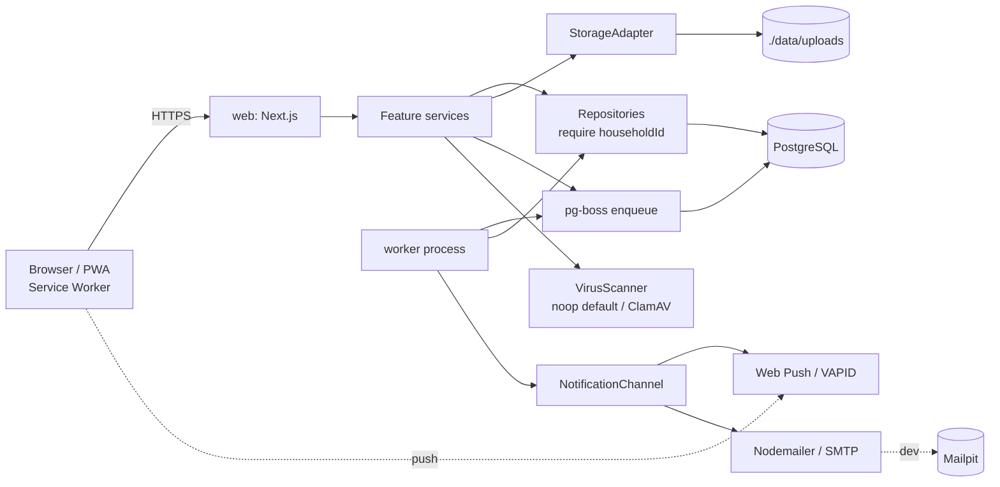

# Architecture

Animal Logbook is a self-hosted, mobile-first, installable PWA for managing everything about your animals. Everything is free and open source (see ADR 0008).

## System overview

Two Node processes share one PostgreSQL database and one upload volume:

- **web**: Next.js (App Router). Serves UI, route handlers, server actions, and authenticated file downloads.
- **worker**: separate Node process (`npm run worker`) running `pg-boss` jobs: reminders, notifications, cleanup.



## Layers and boundaries

```
route handler / server action   (thin: auth, parse with Zod, call service, map result)
        -> service              (business rules, transactions, pure logic helpers)
        -> repository           (Drizzle queries; every function takes householdId)
        -> db
```

- Authn/authz context is built once per request (`requireSession()`, `requireHouseholdAccess(role)`), producing a `Ctx { userId, householdId, role }` that services require.
- Repositories cannot be called without `householdId`; child tables (e.g. `weight_entries`) carry their own `household_id` column (denormalised on purpose) so every query is directly scoped.
- Expected failures return a typed `Result<T, AppError>`; unexpected ones throw and go to the `ErrorReporter` (logs by default).

## Data flow examples

**Upload**: client -> `POST /api/files` (session + household check, size limit) -> stream to temp -> magic-byte check -> `VirusScanner.scan` -> sharp (images: resize, thumbnail, strip EXIF) -> `StorageAdapter.put` -> `files` + `attachments` rows.

**Download**: client asks a server action for a link -> service checks household access -> returns short-lived HMAC-signed token -> `GET /api/files/:id?token=` re-checks session + token + household -> streams file with `Content-Disposition`, `X-Content-Type-Options: nosniff`, `Cache-Control: private`.

**Reminder**: service writes `reminders` rows (source type/id, `due_at` UTC) -> worker tick finds due, unsent reminders -> idempotent claim (`UPDATE ... WHERE claimed_at IS NULL RETURNING`, unique `(reminder_id, channel)` in `notification_deliveries`) -> channels deliver -> `notifications` row for the in-app inbox.

## Folder structure

```
src/
  app/                    Next.js routes only (thin); [locale]/(auth|app)/...; api/
  features/<feature>/     components/ server/ schemas/ hooks/ tests/ index.ts
    animals appointments medical documents medications expenses food
    households auth notifications dashboard
  db/                     schema/ (Drizzle), client.ts, seed.ts
  lib/                    shared: env, result, errors, logger, money, dates, units,
                          storage/, notify/, scan/, security/ (rate-limit, csrf, tokens)
  worker/                 index.ts, jobs/
  i18n/                   request config; messages/{en,nl,fr,de}.json
  sw/                     Serwist service worker source
drizzle/                  generated SQL migrations (committed)
e2e/                      Playwright
docs/ .github/ .run/
data/uploads/             gitignored runtime storage
```

Cross-feature imports go only through `features/<x>/index.ts` (enforced by ESLint `no-restricted-imports`).

## Key trade-offs

| Decision                                         | Benefit                                                       | Cost                                                    |
| ------------------------------------------------ | ------------------------------------------------------------- | ------------------------------------------------------- |
| Modular monolith, 2 processes                    | Simple ops, one DB, one image                                 | Worker/web share code; no independent scaling           |
| pg-boss on Postgres                              | No Redis, transactional enqueue                               | Throughput limits (irrelevant at this scale)            |
| Local disk storage default                       | Zero dependencies                                             | Single node; backups are volume-based. S3 adapter later |
| `household_id` on every table                    | Cross-tenant isolation easy to enforce and test; optional RLS | Slight denormalisation                                  |
| Better Auth over hosted auth                     | Self-hosted, free                                             | We own security configuration                           |
| Reminders as a first-class table                 | Idempotent, auditable, source-agnostic                        | One more table to keep in sync with sources             |
| Offline: cache only emergency card + pinned docs | Small, safe offline surface                                   | No offline writes in V1                                 |

## Cross-cutting

- **Security**: CSP with nonces, HSTS, Postgres-based rate limiting, CSRF (Origin check + SameSite cookies; server actions have built-in protection). See `.github/instructions/security.instructions.md`.
- **Privacy**: export (JSON + files zip) and account deletion in Phase 8; data model supports hard-delete cascade. No external CDNs; fonts self-hosted.
- **i18n**: next-intl, locale in URL; user preferences store `locale`, `timezone`, `weight_unit`, `currency`.
- **Time**: timestamps UTC (`timestamptz`); date-only values are `date`; reminders computed from wall-clock time in the user's IANA zone (DST-safe, ADR 0004).
- **Observability**: `pino` JSON logs with request id; `ErrorReporter` interface (default: log).
