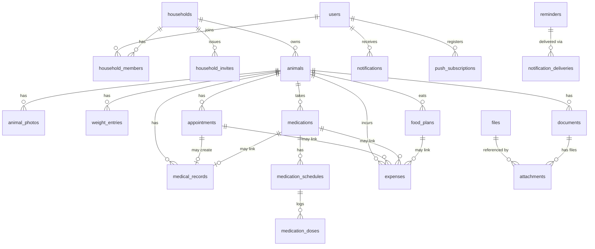

# Data Model

PostgreSQL, Drizzle ORM. Conventions apply to all tables unless noted:

- `id uuid` PK (`gen_random_uuid()`), `created_at`/`updated_at timestamptz not null default now()`.
- User-facing entities also have `deleted_at timestamptz null` (soft delete). Partial indexes use `where deleted_at is null`.
- Every domain table has `household_id uuid not null references households(id) on delete cascade`. Child tables use a composite FK `(animal_id, household_id) -> animals(id, household_id)` so a child can never point at an animal of another household (needs `unique (id, household_id)` on `animals`).
- Money: `amount_minor integer` + `currency char(3)` (ISO 4217). Never floats.
- Timestamps are UTC. Date-only values use `date`. Weights stored as `weight_grams integer` (display converted to kg/lb).
- Postgres enums only for closed sets; extensible sets (species, breed) are lookup tables, and `other` is always allowed.
- Optional defense in depth: RLS policies `household_id = current_setting('app.household_id')::uuid` (ADR 0006).

## ER diagram

## Identity and tenancy

| Table               | Key columns                                                                                                                                                   | Notes                                                                                                                                                                                                                                                                                                                   |
| ------------------- | ------------------------------------------------------------------------------------------------------------------------------------------------------------- | ----------------------------------------------------------------------------------------------------------------------------------------------------------------------------------------------------------------------------------------------------------------------------------------------------------------------- |
| `users`             | `email text` (unique index on `lower(email)`), `name`, `locale`, `timezone` (IANA), `weight_unit` (`kg`/`lb`), `default_currency`, `email_verified` (boolean) | Households are created lazily on first authenticated access (`resolveCtx`), not by a sign-up hook. `rate_limits` (id, key, count, last_request) is shared by Better Auth and our limiter (keys prefixed `app:`). Auth tables (`sessions`, `accounts`, `verifications`) are generated by Better Auth in the same schema. |
| `households`        | `name`, `created_by`, `timezone` (IANA; defaults from the creator, owner-editable; used to display times and compute reminders)                               | Tenancy root. Created lazily on first authenticated access (V1: one per user; model allows more).                                                                                                                                                                                                                       |
| `household_members` | `household_id`, `user_id`, `role` enum(`owner`,`editor`,`viewer`)                                                                                             | `unique(household_id,user_id)`. Exactly one `owner` per household (partial unique index on `household_id where role='owner'`).                                                                                                                                                                                          |
| `household_invites` | `household_id`, `email`, `role`, `token_hash`, `expires_at`, `accepted_at`                                                                                    | Invite by email; accepted by a signed-in account. Token stored hashed.                                                                                                                                                                                                                                                  |

Sharing model: access is granted to a **household** (all its animals). Per-animal sharing is a backlog item. Roles: owner (everything incl. members/deletion), editor (read/write data), viewer (read only).

## Animals

| Table                                | Columns                                                                                                                                                                                                                                                                                                                                                                                                                                                                                   |
| ------------------------------------ | ----------------------------------------------------------------------------------------------------------------------------------------------------------------------------------------------------------------------------------------------------------------------------------------------------------------------------------------------------------------------------------------------------------------------------------------------------------------------------------------- |
| (no `species`/`breeds` tables in V1) | Species is a validated text key (`dog`, `cat`, ... `other`) defined in code; `other` requires `species_other` free text. Breed is free text with suggestions per species plus values already used in the household. Lookup tables can be introduced later without changing the animal columns.                                                                                                                                                                                            |
| `animals`                            | `household_id`, `name`, `species text`, `species_other null`, `breed null`, `gender` enum(`male`,`female`,`unknown`), `birth_date date null`, `birth_date_is_estimate bool`, `color_markings`, `chip_number`, `registration_number`, `sterilized bool null`, `emergency_notes`, `owner_phone`, soft delete. Allergies are **not** a column: they are derived from allergy `medical_records` (ADR 0010). Unique `(id, household_id)`. Check: `species = 'other'` requires `species_other`. |
| `animal_photos`                      | `animal_id`, `household_id`, `file_id` (display WebP), `thumb_file_id` (thumbnail WebP), `is_primary`, soft delete. Partial unique index: one primary photo per animal. Composite FKs to `animals` and `files`.                                                                                                                                                                                                                                                                           |
| `files`                              | `household_id`, `storage_key` unique, `mime_type`, `size_bytes`, `checksum`, `uploaded_by`. Unique `(id, household_id)`. Bytes live behind `StorageAdapter`; EXIF is stripped before storage.                                                                                                                                                                                                                                                                                             |
| `weight_entries`                     | `animal_id`, `household_id`, `measured_at timestamptz`, `weight_grams int > 0`, `note`. Index `(animal_id, measured_at desc)`. Current weight = latest row.                                                                                                                                                                                                                                                                                                                               |

## Care records

| Table                  | Columns                                                                                                                                                                                                                                                                                                                                                                                                                                                                                                                                                                                                                            |
| ---------------------- | ---------------------------------------------------------------------------------------------------------------------------------------------------------------------------------------------------------------------------------------------------------------------------------------------------------------------------------------------------------------------------------------------------------------------------------------------------------------------------------------------------------------------------------------------------------------------------------------------------------------------------------- |
| `appointments`         | `animal_id null`, `type` enum(`vet`,`grooming`,`training`,`vaccination`,`medication`), `title`, `scheduled_at timestamptz`, `timezone` (IANA it was entered in), `cost_minor null`, `currency null` (both or neither; cost >= 0), `notes`, `follow_up_date date null`, soft delete. Unique `(id, household_id)`. Indexes `(household_id, scheduled_at desc) where not deleted`, `(household_id, animal_id, scheduled_at desc)`.                                                                                                                                                                                                    |
| `medical_records`      | `animal_id`, `type` enum(`vaccination`,`surgery`,`illness`,`injury`,`allergy`,`medication`), `title`, `started_on date`, `ended_on date null`, `severity` enum(`mild`,`moderate`,`severe`) null, `next_due_on date null`, `notes`, `appointment_id null`, `imported_from_profile bool`, soft delete. Checks: end >= start; `next_due_on` only for vaccination; severity only for illness/injury/allergy; no end date for vaccination/surgery. **Source of truth for history.**                                                                                                                                                     |
| `medications`          | `animal_id`, `medical_record_id` (unique FK to `medical_records` with `type = medication`), `dosage text`, `created_by`, soft delete. The name, start and end date and notes live on the linked record, so nothing is duplicated; the schedule window is the record's dates. Soft delete and restore move the record, its attachments and its reminders together.                                                                                                                                                                                                                                                                  |
| `medication_schedules` | One per medication (`unique(medication_id)`). `kind` enum(`daily`,`weekdays`,`every_n_days`,`as_needed`), `times text[]` (household-local `HH:MM`), `weekdays smallint[]` (ISO 1-7), `interval_days` (2-365). Checks per kind. `updated_at` is when the schedule was last saved: reminders and adherence only count from then.                                                                                                                                                                                                                                                                                                     |
| `medication_doses`     | `medication_id`, `scheduled_at timestamptz`, `status` enum(`given`,`skipped`,`missed`), `logged_at`, `logged_by null` (null for worker-written `missed`), `note`. `unique(medication_id, scheduled_at)` makes logging idempotent. As-needed doses use the current minute as `scheduled_at`.                                                                                                                                                                                                                                                                                                                                        |
| `food_plans`           | `animal_id`, `brand`, `product_name`, `flavor`, `food_type` enum(`dry`,`wet`,`raw`,`treat`,`supplement`,`other`), `daily_quantity_grams numeric`, `feeding_times time[]`, `timezone`, `started_on date`, `ended_on date null`, `change_reason`, `notes`. Check `ended_on >= started_on`. Diet-change history = ordered plans per animal (overlap allowed, e.g. dry + wet). Allergy investigation joins plans, `weight_entries` and allergy/illness records by date range.                                                                                                                                                          |
| `expenses`             | `animal_id null` (household-level allowed), `category` enum(`vet`,`food`,`insurance`,`grooming`,`toys`,`medication`,`training`,`other`), `incurred_on date` (household-local), `amount_minor >= 0`, `currency`, `description`, `notes null`, `appointment_id null` (`unique`), `medication_id null` (composite FK), `food_plan_id null` (FK added in Phase 7), soft delete. The appointment's cost is _input_; the service upserts the one linked expense in the same transaction, so `expenses` is the only source for totals (no double entry). Totals exclude deleted expenses and expenses of deleted appointments (ADR 0012). |

## Files

| Table         | Columns                                                                                                                                                                                                                                                                                                                                                                                                                          |
| ------------- | -------------------------------------------------------------------------------------------------------------------------------------------------------------------------------------------------------------------------------------------------------------------------------------------------------------------------------------------------------------------------------------------------------------------------------- |
| `files`       | `household_id`, `storage_key` unique, `mime_type`, `size_bytes`, `sha256`, `original_name`, `uploaded_by`, `scan_status` enum(`skipped`,`clean`,`infected`), `thumbnail_key null`, `width`, `height`.                                                                                                                                                                                                                            |
| `attachments` | `file_id`, `household_id`, `owner_type` enum(`appointment`,`medical_record`,`expense`,`document`), `owner_id uuid`. Polymorphic; integrity by service + cleanup job. Index `(owner_type, owner_id)`.                                                                                                                                                                                                                             |
| `documents`   | `animal_id null`, `type` enum(`registration`,`vaccination`,`insurance`,`invoice`,`passport`,`other`), `title`, `issued_on date null`, `expires_on date null`, `notes`, search is `ILIKE` over title, notes and file name (wildcards escaped); composite FK `(animal_id, household_id)` to animals. `files.original_name` holds the sanitised upload name; `users.phone` is the optional owner phone shown on the emergency card. |

## Reminders and notifications

| Table                      | Columns                                                                                                                                                                                                                                                                                                                                                                                                                        |
| -------------------------- | ------------------------------------------------------------------------------------------------------------------------------------------------------------------------------------------------------------------------------------------------------------------------------------------------------------------------------------------------------------------------------------------------------------------------------ |
| `reminders`                | `household_id` (recipients resolved at delivery), `source_type` enum(`follow_up`,`vaccination_due`,`medication_dose`,`document_expiry`,`low_stock`), `source_id`, `animal_id null`, `title` (snapshot), `due_at timestamptz` (09:00 household-local), `claimed_at`, `done_at`, `cancelled_at`, `expired_at` (older than the stale window, never sent). `unique(source_type, source_id, due_at)` so regeneration is idempotent. |
| `notification_deliveries`  | One row per attempt target: `reminder_id`, `user_id`, `channel` enum(`email`,`push`), `status` enum(`pending`,`sending`,`sent`,`failed`,`skipped`), `attempts`, `next_attempt_at`, `claimed_at` (lease), `last_error`, `sent_at`. `unique(reminder_id, user_id, channel)` gives exactly-once per recipient and channel. See ADR 0011.                                                                                          |
| `notifications`            | `user_id`, `reminder_id null`, `title`, `body`, `url`, `read_at`. In-app inbox.                                                                                                                                                                                                                                                                                                                                                |
| `push_subscriptions`       | Per device and per user (not per household): `user_id`, `endpoint unique`, `p256dh`, `auth`, `user_agent`. Removed on 404/410 or when the user unsubscribes.                                                                                                                                                                                                                                                                   |
| `notification_preferences` | `user_id`, `channel`, `enabled`. `unique(user_id, channel)`. A missing row means on.                                                                                                                                                                                                                                                                                                                                           |

## Security support

- `rate_limits(key text pk, window_start, count)`: Postgres-backed limiter.
- `audit_log(household_id, user_id, action, entity, entity_id, at)`: sharing, deletion, export events.

## Indexes summary

- `(household_id, ...)` leads every list index; partial `where deleted_at is null`.
- Timelines: `(animal_id, occurred_on desc)`, `(animal_id, scheduled_at desc)`, `(animal_id, measured_at desc)`.
- Expenses: `(household_id, incurred_on)`, `(household_id, category, incurred_on)`.
- Unique: `animals(id, household_id)`, `household_members(household_id,user_id)`, `files(storage_key)`, `push_subscriptions(endpoint)`.

## Deletion semantics

Soft delete hides rows in all repositories by default. A purge job hard-deletes after a retention window (default 30 days) and removes orphan files. Account deletion hard-deletes the household if the user is its sole owner; otherwise only membership is removed.

## Derived values (never hand-edited)

Current weight, animal age, `allergy_summary`, medication active state, document/vaccination expiry status, monthly/annual/category spend.
